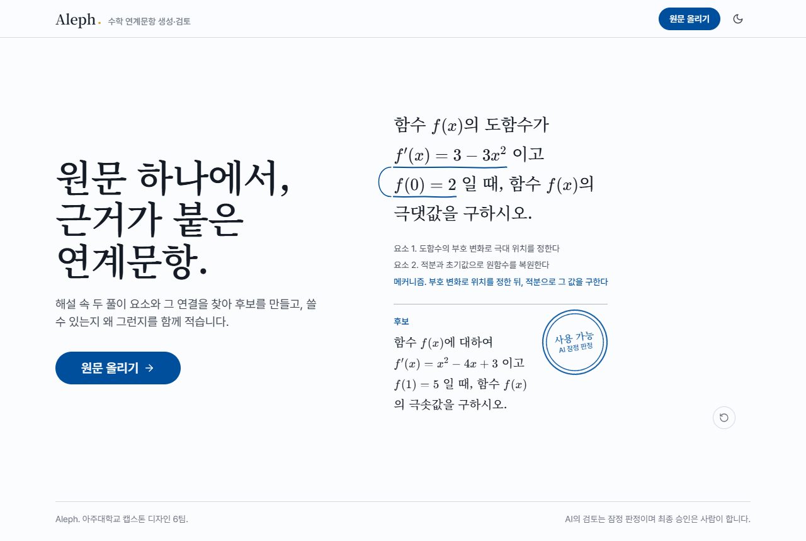
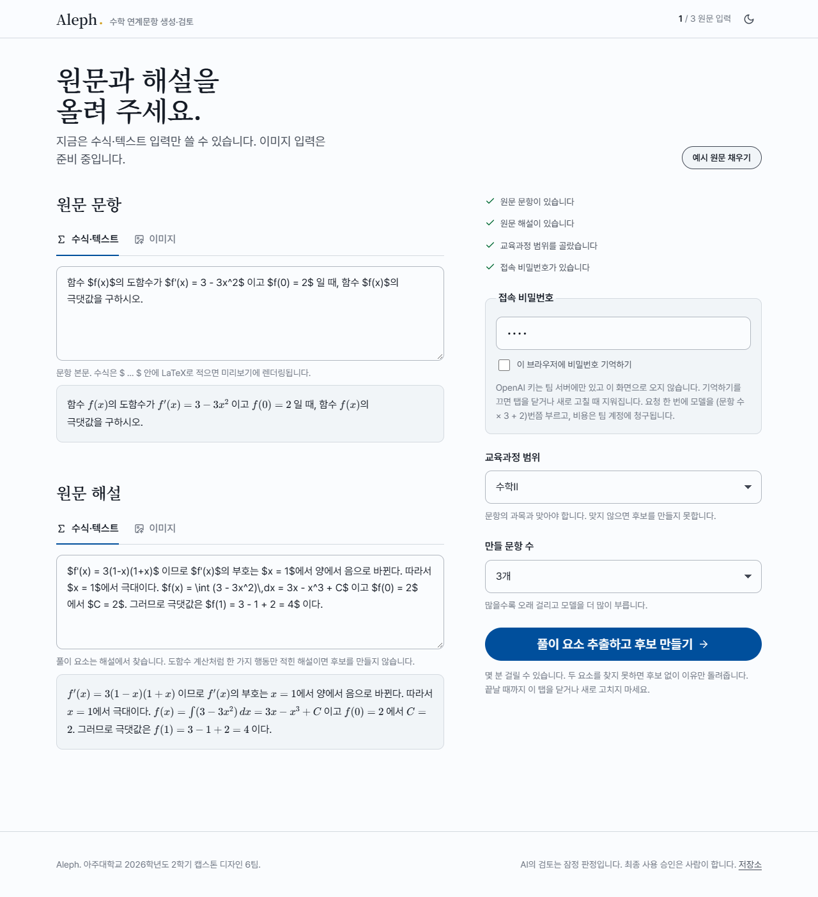
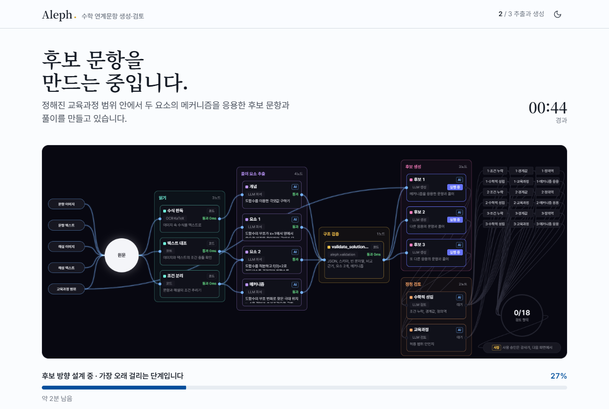
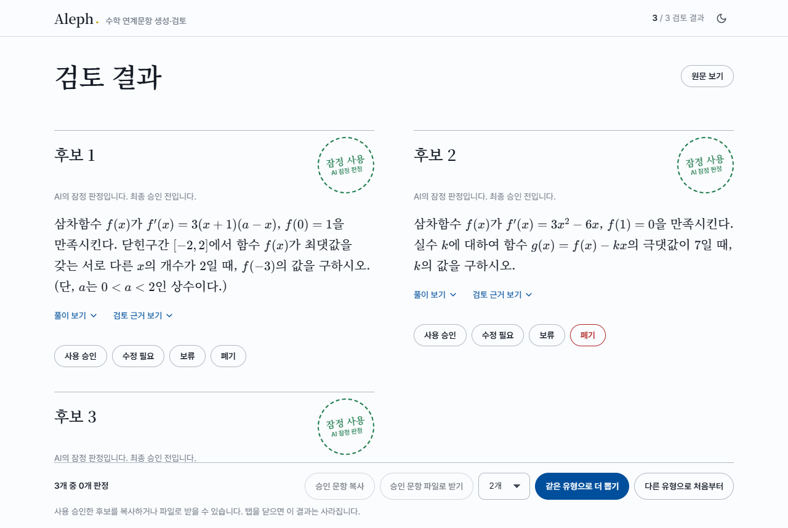
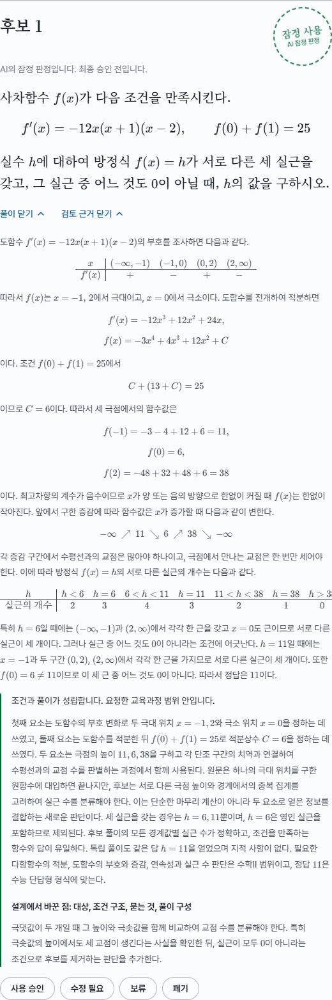
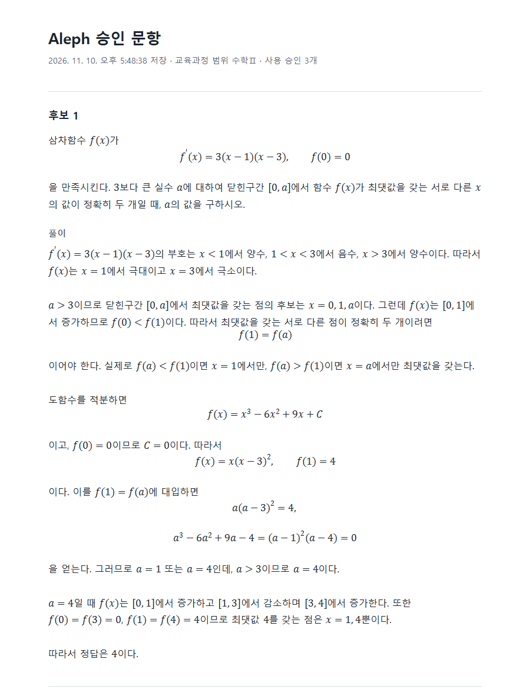
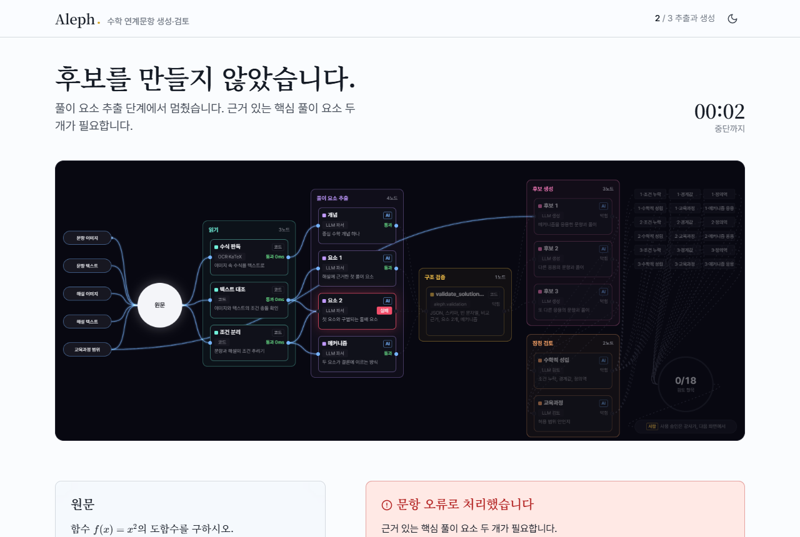

# Aleph — 캡스톤 디자인 6팀

> 아주대학교 2026학년도 2학기 캡스톤 디자인 · 6팀 저장소
>
> 원본문항의 핵심 풀이 요소를 구조화해 연계문항 후보를 만들고, 수학적 성립·교육과정 문제를 검토 근거와 함께 제시하는 도구

## 목차

- [MVP 사용자 가이드](#mvp-사용자-가이드)
- [팀 소개](#팀-소개)
- [팀원](#팀원)
- [프로젝트 개요](#프로젝트-개요)
- [기술 스택](#기술-스택)
- [로컬 실행](#로컬-실행)
- [협업 규칙](#협업-규칙)

## MVP 사용자 가이드

> 2026학년도 2학기 AI 캡스톤디자인 MVP 리뷰를 위한 안내입니다. 리뷰 기간(11월 11일~18일)에는 아래 주소를 계속 열어 둡니다. 주소나 사용 방법이 바뀌면 이 절을 먼저 고칩니다.

### 서비스 소개

| 항목 | 내용 |
| :--- | :--- |
| 팀 | 6팀 Aleph |
| 서비스 | Aleph, 수학 연계문항 생성·검토 도구 |
| 대상 사용자 | 기존 문항(원문)을 바탕으로 연계문항을 만들거나 검토하는 학원 수학 강사와 문항 제작자 |
| 해결하려는 문제 | 연계문항을 만들 때 원문의 핵심 풀이 의도를 살리면서 새 조건과 풀이가 맞는지 확인하느라 수정과 재검토를 여러 번 반복합니다. |
| 이번 MVP에서 쓸 수 있는 기능 | ① 원문 문항과 해설을 넣으면 해설에서 핵심 풀이 요소 2개와 두 요소의 연결(메커니즘)을 찾습니다.<br>② 그 연결을 응용한 연계문항 후보를 1~5개(기본 3개) 만들고 풀이를 붙입니다.<br>③ 후보마다 AI가 문항만 보고 다시 풀어 본 뒤 수학적 성립, 교육과정 범위, 원문을 베꼈는지를 잠정 검토합니다.<br>④ 사람이 후보마다 사용 승인, 수정 필요, 보류, 폐기를 기록합니다. AI의 판정은 잠정이고, 사용 승인은 사람만 할 수 있습니다.<br>⑤ 사용 승인한 문항과 풀이를 HTML 파일로 받거나 LaTeX 글자로 복사합니다.<br>⑥ 결과를 보고 같은 유형으로 후보를 더 뽑거나, 다른 유형으로 처음부터 다시 시작합니다. |

### 접속 방법

| 항목 | 내용 |
| :--- | :--- |
| 접속 주소 | https://aleph.aleph-web.workers.dev |
| 접속 비밀번호 | `3780` (신청할 필요 없이 입력 화면의 "접속 비밀번호" 칸에 넣습니다) |
| 설치 | 필요 없습니다. 브라우저로 주소를 엽니다. |
| 지원 환경 | PC의 Chrome 또는 Edge 최신 버전(권장)과 인터넷 연결. 휴대폰 브라우저에서도 열리지만 화면이 좁습니다. |
| 소스 코드 | 이 저장소의 `main` 브랜치. 화면은 [web/](web/), 생성·검토 파이프라인은 [src/aleph/](src/aleph/)에 있습니다. 직접 띄우는 방법은 [로컬 실행](#로컬-실행)에 있습니다. |

### 핵심 기능 체험 순서 (약 10분)

- 역할: 학원 수학 강사
- 목표: 원문 한 문항으로 연계문항 후보 3개를 받고, 그중 하나를 직접 풀어 본 뒤 판정을 기록하고, 승인한 문항을 파일로 받습니다.

1. 접속 주소를 열고 **원문 올리기**를 누릅니다.

   

2. 입력 화면 오른쪽 위의 **예시 원문 채우기**를 누릅니다. 아래 예시가 채워지고 교육과정 범위는 수학Ⅱ가 됩니다.
   - 원문 문항: 함수 $f(x)$의 도함수가 $f'(x)=3-3x^2$이고 $f(0)=2$일 때, 함수 $f(x)$의 극댓값을 구하시오.
   - 원문 해설: $f'(x)=3(1-x)(1+x)$이므로 $f'(x)$의 부호는 $x=1$에서 양에서 음으로 바뀐다. 따라서 $x=1$에서 극대이다. $f(x)=\int(3-3x^2)\,dx=3x-x^3+C$이고 $f(0)=2$에서 $C=2$. 그러므로 극댓값은 $f(1)=4$이다.

3. **접속 비밀번호** 칸에 `3780`을 넣습니다. **만들 문항 수**는 기본값 3개로 두고(1~5개를 고를 수 있습니다) **풀이 요소 추출하고 후보 만들기**를 누릅니다.

   

4. 진행 화면이 열립니다. 후보 3개면 2~5분 걸리며, 그동안 탭을 닫거나 새로 고치지 않습니다. 그래프로 지금 어느 단계를 누가(AI, 코드, 사람) 하는지, 아래 진행 바로 남은 시간을 봅니다.

   

5. 끝나면 **검토 결과** 화면으로 바뀌고 후보 3개가 나옵니다.

   

6. 후보 하나를 골라 먼저 직접 풀어 봅니다. 그다음 **풀이 보기**로 후보의 풀이를, **검토 근거 보기**로 AI가 그렇게 판정한 이유를 확인합니다.

   

7. 후보 아래 네 버튼(**사용 승인**, **수정 필요**, **보류**, **폐기**) 중 하나를 눌러 판정을 기록합니다. 버튼은 그대로 남아 있어, 잘못 눌렀으면 다른 버튼을 눌러 바꿀 수 있습니다. **검토 근거 보기** 옆의 **Undo**를 누르면 내 판정이 취소되고 AI 잠정 판정으로 돌아갑니다.

8. 화면 아래 막대에서 판정 현황을 보고, **승인 문항 파일로 받기**를 누릅니다. 사용 승인한 문항과 풀이가 HTML 파일 한 개로 저장됩니다. 파일을 더블클릭하면 인터넷 없이도 브라우저에서 수식까지 보이고, 브라우저의 인쇄 기능으로 PDF로 만들 수 있습니다. **승인 문항 복사**를 누르면 같은 내용을 `$ … $` LaTeX 글자로 복사합니다.

   

   

9. 같은 유형의 문항을 더 받으려면 옆의 칸에서 개수를 고르고(기본 2개, 1~5개) **같은 유형으로 더 뽑기**를 누릅니다. 찾아 둔 두 요소와 메커니즘을 그대로 쓰면서 이미 나온 후보와 겹치지 않게 그 수만큼 더 만들어 같은 결과 화면에 붙입니다. 해 둔 판정은 그대로 남고, 한 결과의 후보는 9개까지입니다.

10. 다른 문항으로 시작하려면 **다른 유형으로 처음부터**를 누릅니다. 빈 입력 화면으로 돌아갑니다.

### 기대 결과와 확인 방법

- 진행 화면 그래프의 "풀이 요소 추출" 카드와 아래 "지금까지 찾은 것"에 개념, 요소 1, 요소 2, 메커니즘이 채워집니다. 예시에서는 "도함수의 부호 변화로 극대 위치 찾기"와 "적분하고 $f(0)=2$로 원함수 구하기"에 해당하는 두 요소가 나옵니다(표현은 실행마다 조금씩 다릅니다).
- 결과 화면에는 후보 1~3이 나오고, 후보마다 문항, 접힌 풀이와 검토 근거, AI의 잠정 판정을 뜻하는 점선 도장(잠정 사용, 수정 필요, 보류, 폐기)이 붙습니다. 후보 문항은 실행할 때마다 새로 만들어지므로 그림과 다를 수 있습니다.
- 검토 근거에는 조건과 풀이가 성립하는지, 요청한 교육과정 범위 안인지, 설계에서 원문과 무엇을 바꿨는지(대상, 조건 구조, 묻는 것 등)가 적힙니다.
- **사용 승인**을 누르면 도장이 실선의 "사용 가능 · 강사 승인"으로 바뀝니다. 수정 필요, 보류, 폐기는 "강사 판정"으로 남습니다. AI가 수학적 결함이나 교육과정 이탈을 표시한 후보는 사용 승인 버튼이 꺼져 있습니다.
- 직접 원문을 넣을 때 수식은 `$ … $` 안에 LaTeX로 적고(입력 칸 아래에 미리보기가 나옵니다), 해설도 함께 넣어야 합니다. **교육과정 범위**는 문항의 과목에 맞게 직접 골라야 합니다.
- 후보 없이 멈추는 경우도 확인할 수 있습니다. 원문 문항에 `함수 $f(x)=x^2$의 도함수를 구하시오.`, 해설에 `미분하면 $f'(x)=2x$이다.`처럼 풀이 요소가 하나뿐인 입력을 넣으면 몇 초 안에 "문항 오류로 처리했습니다"가 뜨고 후보를 만들지 않습니다. 두 요소를 찾지 못하면 억지로 만들지 않는 것이 의도한 동작입니다.

  

### 알아 둘 점 (제한과 알려진 문제)

- **이미지 입력은 아직 안 됩니다.** 입력 화면에 이미지 탭이 있지만 수식·텍스트만 받습니다. 진행 그래프의 "읽기"(수식 판독, 텍스트 대조, 조건 분리)는 이미지 입력을 위해 그려 둔 단계라 텍스트 입력에서는 바로 통과합니다.
- **결과는 서버에 저장되지 않습니다.** 결과와 판정 기록은 그 브라우저 탭에만 남고, 탭을 닫으면 사라집니다. 필요한 문항은 사용 승인한 뒤 파일로 받아 주세요. 파일과 복사에는 사용 승인한 문항만 들어갑니다.
- **수정 필요, 보류, 폐기는 기록만 남습니다.** 이유를 적어 문항을 고쳐 쓰게 하는 기능은 아직 없습니다. 판정 이유도 정해진 문구로 저장됩니다.
- **후보 3개면 2~5분 걸립니다.** 후보 방향을 정하는 설계 단계가 가장 오래 걸리고, 후보 수가 많을수록 길어집니다(1개 약 1분, 3개 약 2분, 5개 약 3분).
- **하루 사용 한도가 있습니다.** 모든 사용자를 합쳐 하루 모델 호출 450번, 후보 3개 기준 약 40회까지 만들 수 있습니다(더 뽑기는 호출 (개수 × 3 + 1)번입니다). 다 쓰면 "오늘 사용 한도를 다 썼습니다"가 뜨고, 매일 자정(한국 시간)에 다시 채워집니다.
- **AI 판정은 잠정입니다.** 후보의 정답이 틀리거나 조건이 성립하지 않을 수 있고, AI가 이를 놓칠 수도 있습니다. 사람이 직접 풀어 보고 판정하는 것이 이 서비스의 전제입니다.
- **"확인이 필요합니다"**와 함께 교육과정 범위 안에서 설계할 수 없다는 안내가 뜨면, 고른 범위가 문항의 과목과 맞지 않는 경우입니다(예: 미적분 문항을 수학Ⅰ로 보낸 경우). **범위 다시 고르기**를 누르면 입력한 글은 그대로 있으니 범위만 골라 다시 보냅니다.
- **"모델 출력을 쓸 수 없습니다"**가 뜰 수 있습니다. 모델 출력이 정해진 형식을 두 번 연속 어긴 경우이며, 어긴 규칙이 화면에 적힙니다. **원문 다시 올리기**를 누르면 입력한 글이 그대로 남아 있어 다시 보낼 수 있습니다.
- **"모델을 호출하지 못했습니다"**는 네트워크나 OpenAI 쪽의 일시 오류입니다. 잠시 뒤 다시 시도해 주세요.
- 고등학교 수학Ⅰ, 수학Ⅱ, 미적분 범위의 문항을 다룹니다. 예시 후보를 판정하는 데는 수학Ⅱ(미분과 적분) 정도의 지식이면 충분합니다.
- 애니메이션이 보이지 않으면 컴퓨터의 "애니메이션 효과 끄기(동작 줄이기)" 설정 때문입니다. 기능에는 영향이 없습니다.
- 오류나 이상한 결과를 만나면 이 저장소의 [Issues](https://github.com/juhyun302/capstone-2026-team6/issues)에 화면 캡처와 함께 남겨 주세요.

## 팀 소개

아주대학교 캡스톤 디자인 6팀 **Aleph**입니다. 팀원 3명과 AI 에이전트가 하나의 저장소에서
브랜치 기반으로 협업하며 프로젝트를 진행합니다.

## 팀원

| 이름 | 학번 | 역할 | GitHub |
| :--- | :--- | :--- | :--- |
| 윤결 (팀장) | 202126823 | 프로젝트 리드 | [@Sora3780](https://github.com/Sora3780) |
| 김민성 | 202122632 | 문서작업  | [@Imeanstar](https://github.com/Imeanstar) |
| 이주현 | 202126924 | git admin | [@juhyun302](https://github.com/juhyun302) |

## 프로젝트 개요

| 항목 | 내용 |
| :--- | :--- |
| 프로젝트명 | Aleph |
| 주제 | 수학 연계문항 후보의 조건·풀이 성립 검토를 돕는 생성·검토 도구 |
| 1차 사용자 | 원본문항으로 연계문항을 만들거나 검토하는 수학 문항 제작자와 학원 수학 강사. 문항을 풀기만 하는 학생과 문항 판매·정산 담당자는 현재 비대상이다. |
| 배경 및 필요성 | 수학 연계문항을 직접 제작·검토하는 강사와 문항 제작자는 원문의 핵심 풀이 의도를 유지하면서 조건과 풀이의 성립을 한 번에 확인하기 어려워, 후보 문항의 조건 수정과 재검토를 반복한다. 인터뷰 10건 중 7건에서 이런 추가 작업이 확인됐다. 자세한 근거는 [문제 정의서](docs/PROBLEM.md)에 있다. |
| 목표 | 원본문항과 해설을 입력받아 <br>(1) 핵심 풀이 요소 두 가지와 두 요소의 연결 메커니즘을 구조화해 추출하고, <br>(2) 이를 응용한 연계문항 후보와 풀이를 만들며, <br>(3) 조건 누락·경계값·수학적 성립·교육과정 문제를 검토 근거와 함께 제시한다. <br>AI의 검토는 잠정 판정이며 최종 사용 승인은 사람이 한다. 개발자 1차 통과율과 수학 강사 2차 통과율 각각 70% 이상을 목표로 한다. 자세한 범위와 수용 기준은 [제품 스펙](docs/SPEC.md)에 있다. |
| 기대 효과 | 강사·제작자가 후보 문항의 조건과 풀이 성립을 확인하며 반복하는 수정·재검토 부담을 줄이는 것을 목표로 한다. 검토 근거가 쌓이면 개념별 문항 추천으로 확장할 수 있다(현재 범위 밖). 실제 학생 풀이 데이터 없이 정답률이나 난도를 확정하지는 않는다. |

## 기술 스택

| 영역 | 사용 기술 |
| :--- | :--- |
| 생성·검토 파이프라인 | Python 3.12, jsonschema, FastAPI(로컬 서버). 프롬프트와 스키마는 [src/aleph/](src/aleph/)에 있습니다. |
| 웹 화면 | React 19, Vite, TypeScript, KaTeX(수식), anime.js·motion(애니메이션) |
| 모델 | OpenAI Responses API, `gpt-6-astra` |
| 배포 | Cloudflare Workers. 배포한 웹에서는 같은 파이프라인의 TypeScript 이식본이 브라우저에서 돌고, 워커는 접속 비밀번호와 하루 한도를 확인한 뒤 모델 호출만 중계합니다. |

## 로컬 실행

원문과 해설을 넣으면 후보 문항 3개와 AI 잠정 검토를 받는 화면을 내 컴퓨터에서 띄웁니다. 서버에 로그인이 없으므로 공개된 곳에 띄우지 않습니다.

준비물: Python 3.12, Node.js 20.19 이상, OpenAI API 키

1. 저장소를 받습니다(`main` 브랜치).

   ```bash
   git clone https://github.com/juhyun302/capstone-2026-team6.git
   cd capstone-2026-team6
   ```

2. Python 패키지를 설치합니다.

   ```bash
   python -m venv .venv
   .venv\Scripts\activate        # macOS·Linux: source .venv/bin/activate
   pip install -r requirements.txt -r requirements-dev.txt
   ```

3. `.env.example`을 `.env`로 복사하고 `OPENAI_API_KEY=` 뒤에 키를 넣습니다. `.env`는 Git에 올라가지 않습니다.

4. 터미널 하나에서 서버를 띄웁니다.

   ```bash
   python scripts/run_server.py
   ```

5. 다른 터미널에서 화면을 띄웁니다.

   ```bash
   cd web
   npm install
   npm run dev
   ```

6. 브라우저에서 http://localhost:5173 을 엽니다.

- 원문과 해설은 수식·텍스트로 넣습니다. 이미지 입력은 아직 지원하지 않습니다.
- 요청 한 번에 2~5분이 걸리고 모델을 (후보 수 × 3 + 2)번, 기본 3개면 11번 호출합니다. 호출 비용은 `.env`의 키로 청구됩니다.
- 결과는 서버를 끄면 사라집니다.
- 검사: `python -m ruff check .`, `python -m pytest -q -rs`

### HTML 파일 하나로 쓰기

서버 없이 HTML 파일 하나를 더블클릭해 문항을 만듭니다. 파이프라인이 브라우저 안에서 돌고, 화면에 넣은 OpenAI 키로 OpenAI를 직접 부릅니다. 프롬프트와 스키마는 `src/aleph`의 파일을 그대로 묶습니다.

```bash
cd web
npm install
npm run build:single      # web/dist-single/aleph.html 이 만들어집니다
```

- `aleph.html`을 Chrome이나 Edge로 엽니다. 인터넷 연결이 필요합니다.
- 오른쪽 "OpenAI API 키" 칸에 키를 넣습니다. 키는 그 브라우저에서 OpenAI로만 갑니다. "이 브라우저에 키 기억하기"를 켜면 그 브라우저에만 저장되고, 끄면 탭을 닫을 때 지워집니다.
- 호출 비용은 키 주인 계정에 청구됩니다. 키를 다른 사람과 나누지 말고 각자 자기 키를 넣습니다.
- 생성이 끝날 때까지 탭을 닫거나 새로 고치지 않습니다. 결과는 그 탭에 남고, 탭을 닫으면 사라집니다.

### 웹에 올리기 (접속 비밀번호)

팀 OpenAI 키 하나로 여러 사람이 웹에서 쓰게 합니다. Cloudflare Workers 하나가 화면을 띄우고 `/api/*`를 받습니다([web/worker/index.ts](web/worker/index.ts)).

- 키는 Cloudflare 비밀값으로만 저장되고 브라우저로 오지 않습니다.
- 접속 비밀번호가 맞는 요청만 OpenAI로 넘깁니다. 틀리면 1초 늦게 거절합니다.
- 브라우저는 프롬프트 이름만 보내고, 워커가 `src/aleph/prompts`의 본문을 골라 붙입니다. 그래서 비밀번호를 알아도 Aleph의 다섯 작업 말고는 키를 쓸 수 없습니다. 모델은 [web/wrangler.jsonc](web/wrangler.jsonc)의 `OPENAI_MODEL`로 고정합니다.
- 2분 넘게 걸리는 호출이 중간에 끊기지 않도록, 기다리는 동안 10초마다 공백을 보냅니다.
- 하루(한국 시간) 모델 호출 수를 [web/wrangler.jsonc](web/wrangler.jsonc)의 `DAILY_CALL_LIMIT`(기본 450, 후보 3개 요청 약 40건)으로 제한합니다. 사이트 전체의 호출 수를 Durable Object 하나가 셉니다. 남은 한도가 가장 큰 요청 한 건(후보 5개, 17번)보다 적으면 새 요청을 시작하지 않습니다. 비밀번호를 README에 공개해도 하루 비용에 상한이 있도록 한 장치입니다.

처음 한 번(`web` 폴더에서):

```bash
npx wrangler login                        # 브라우저에서 Cloudflare 로그인(무료 계정)
npm run deploy                            # 화면 빌드 후 배포, 주소 https://aleph.<계정>.workers.dev 출력
npx wrangler secret put OPENAI_API_KEY    # 이 용도로 새로 만든 키를 붙여 넣기
npx wrangler secret put ACCESS_PASSWORD   # 팀에 나눌 긴 비밀번호
```

- 비밀값을 넣기 전에는 `/api/*`가 503을 돌려줍니다.
- 비밀번호를 바꾸려면 `npx wrangler secret put ACCESS_PASSWORD`를 다시 실행합니다. 기존 비밀번호는 바로 막힙니다.
- 코드를 고친 뒤에는 `npm run deploy`만 다시 실행합니다.
- OpenAI에서 이 키 전용 프로젝트를 만들고 월 사용 한도를 걸어 둡니다. 비밀번호를 아는 사람은 요청을 여러 번 보낼 수 있기 때문입니다.
- 로컬 확인: `web/.dev.vars`에 `OPENAI_API_KEY=`와 `ACCESS_PASSWORD=`를 적고 `npm run build:web && npx wrangler dev`를 실행합니다. `.dev.vars`는 Git에 올라가지 않습니다.

## 협업 규칙

### 브랜치 이름

브랜치 이름은 `종류/w주차-작업명` 형식을 사용합니다. 종류와 작업명은 영문 소문자로
작성하고, 작업명의 단어는 하이픈(`-`)으로 구분합니다.

- 사용 종류: `feat`, `fix`, `docs`, `refactor`, `test`, `chore`
- 예시: `feat/w06-question-upload`, `docs/w05-pr-convention`

### PR 제목

PR 제목은 주차를 대괄호로 가장 먼저 표시한 `[N주차] 작업 요약` 형식을 사용합니다.

- 예시: `[5주차] PR 작성 규칙 추가`
- 예시: `[6주차] 문항 업로드 기능 구현`
